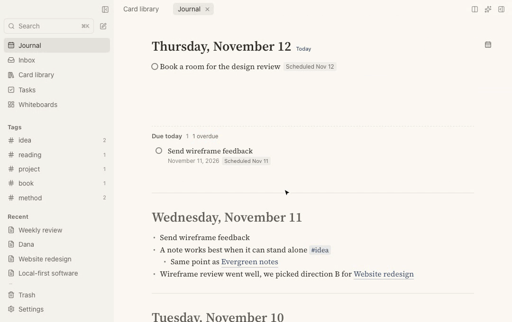
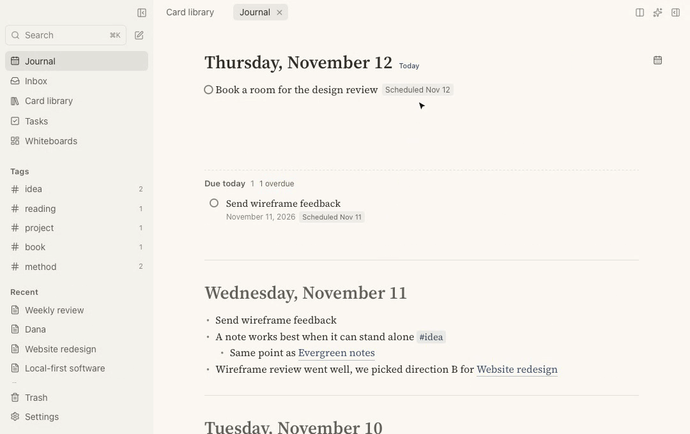
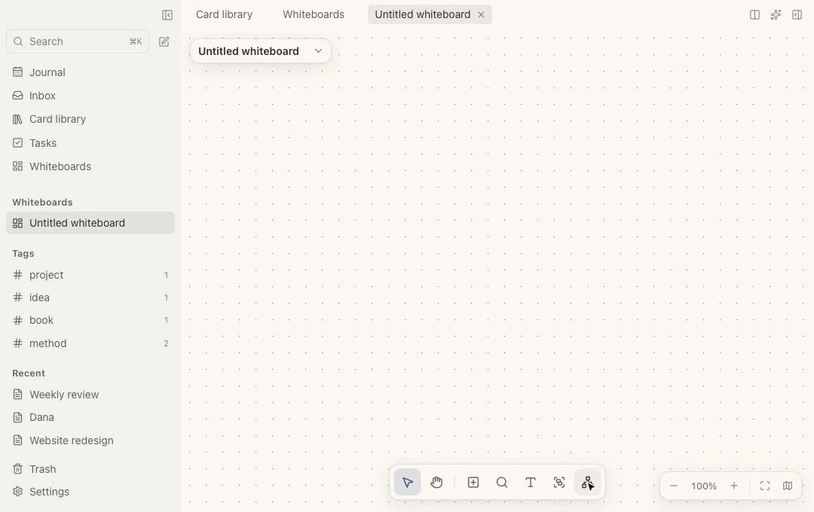
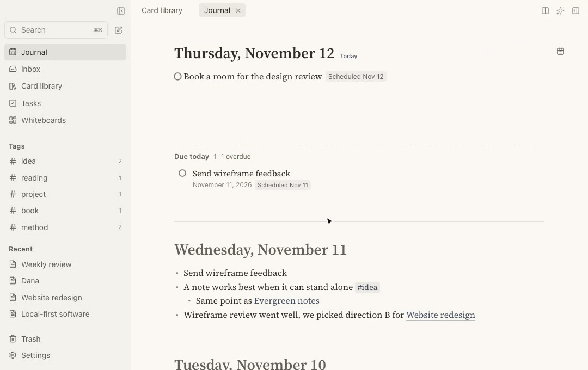
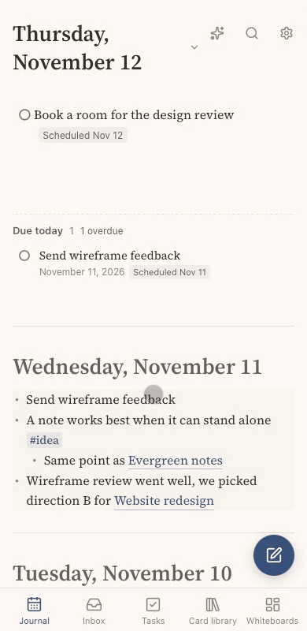
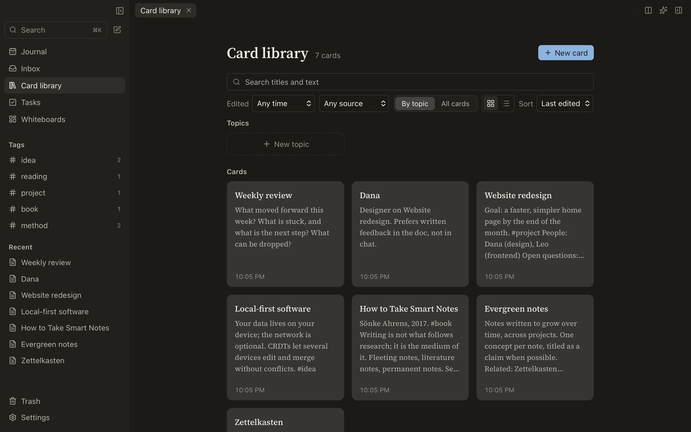

<p align="center"></p>
<h1 align="center">Folio</h1>
<p align="center"><b>English</b> · <a href="README.zh-CN.md">简体中文</a></p>

<p align="center"><b>A local-first note app for people who think in outlines and links.</b><br>
A daily journal, linked cards, tasks, live queries and whiteboards in one fast app.<br>
Your notes stay on your own device.</p>

<p align="center"><a href="#download"><b>Download</b></a> · <a href="#features">Features</a> · <a href="#self-hosting-the-sync-server">Sync server</a> · <a href="#development">Development</a></p>



## Why Folio

- **Your notes are yours.** They live in a SQLite file on your device and work offline. No account, no cloud you have to trust. Export everything to Markdown whenever you like.
- **One app instead of three.** An outliner with a daily journal, a card library, a task manager and a whiteboard share the same notes and the same links.
- **Simple first, powerful when you need it.** Just open today and type. Links, tags, queries and tag fields are there when a note needs them, and never in the way before that.
- **Fast and small.** A native app built with Tauri and Rust, on macOS, Windows, Linux and Android.

## A quick tour

### Write the way you think

Open the journal and type. `[[` links a card, `#` adds a tag, `/` opens every command, Tab indents. Each card lists what links to it, so a line written today turns up next to the project or person it mentions.

### Ask your notes questions

A query block lists the tasks, blocks or cards that match your conditions, and stays current as you write. Start from a common query, adjust the conditions by clicking, or type it as text: `task:open #project due:<=+7d`. Tasks can be ticked right in the results.



### Lay ideas out on a whiteboard

Put cards on a canvas, connect them, frame them in sections, or build a mind map with the keyboard: Tab for a subtopic, Enter for the next one. Boards export as JSON Canvas, which Obsidian opens.



### Find anything

`⌘K` searches titles and text across cards, journal and blocks as you type, with filters for time and tag.



### In your pocket

The same notes on Android, laid out for one hand. Capture a thought in two taps, tick off tasks, and read any card with everything that links to it.

<p align="center"></p>

### Light and dark



## Features

**Writing**
- One editor for the journal and for cards: outlines that fold, headings, tables, code blocks, math, Mermaid diagrams, images and files.
- Card links, block references and embeds, backlinks and unlinked mentions.
- Templates, and a version history for every card.

**Organising**
- Tags with fields: give a tag a status or a date field and see its cards as a table or a board.
- Query blocks: live lists of tasks, blocks or cards, by clicking or as text.
- Topics to group cards, an inbox for links and quick thoughts (on Android, share to Folio from any app).
- Whiteboards and mind maps.
- Search and commands from `⌘K`.

**Getting things done**
- Tasks with statuses, priorities, scheduled and due dates.
- A task page, a calendar, and habits.

**Your data**
- Stored in SQLite on your device; works offline.
- Automatic backups, with an optional encrypted copy in a folder you choose; deleted cards go to the trash and can be restored.
- Export to Markdown or PDF at any time.
- Sync (in development): end-to-end encrypted, through a server you host yourself. The server only ever sees encrypted data. Loro CRDTs merge edits from several devices without conflicts.

**AI, if you want it**
- An assistant that uses your own API key (Anthropic or any OpenAI-compatible provider) and shows its edits for you to review.
- An MCP server, so other AI tools can read and write your notes with your approval.

English and 简体中文. macOS, Windows, Linux and Android; iOS is planned.

## Download

Get the latest version from [Releases](https://github.com/linlih/folio/releases/latest):

| Platform | File |
|---|---|
| macOS (Apple Silicon and Intel) | `Folio_x.y.z_universal.dmg` |
| Windows | `Folio_x.y.z_x64-setup.exe` or `.msi` |
| Linux | `.AppImage`, `.deb` or `.rpm` |
| Android (arm64) | `folio-android-arm64.apk` |

Desktop apps check for updates once a day and ask before installing (the AppImage on Linux; `.deb` / `.rpm` update through your package manager). The Android app tells you when a new APK is out.

The builds are not yet signed by Apple or Microsoft. On macOS, allow the app the first time in **System Settings → Privacy & Security**; on Windows, choose **More info → Run anyway**.

## Self-hosting the sync server

On a Linux server with systemd, point a domain at it, then run:

```bash
curl -fsSL https://raw.githubusercontent.com/linlih/folio/main/scripts/install-server.sh | sudo bash -s -- --domain sync.example.com
```

The script installs everything under `/opt/folio-sync` (program, settings and token, data, logs rotated daily) as the systemd service `folio-sync`, sets up HTTPS with Caddy (when the machine has none, Caddy's official release is installed into `/opt/folio-sync`, checksum-verified and run as the service `folio-sync-caddy`, with no package manager needed; when it has one, the script asks before adding a site to your Caddyfile; `--https-port` picks another port than 443), and prints the server address and token to enter in **Settings → Sync** in the app. The server only ever sees encrypted data.

Run on a terminal without options, it asks step by step for the domain, the public HTTPS port (443 by default; another port avoids most scanning) and the local port, then shows the plan and changes nothing until you agree. For unattended installs pass `--domain`, `--https-port`, `--port` and `--yes`.

Manage it with the `folio-sync` command:

```
folio-sync status | start | stop | restart | logs -f | info | upgrade | uninstall [--purge]
```

## Development

Built with Tauri 2, React and Rust.

### Repository layout

```
crates/
  folio-core/     Domain model: document ids, card document structure (Loro), extraction; no IO
  folio-store/    SQLite: the only writer, change log, derived indexes, device settings
  folio-sync/     Sync client
  folio-io/       Import and export
  folio-ai/       AI assistant: model providers (Anthropic, OpenAI-compatible)
  folio-mcp/      MCP server (AI access to notes)
  folio-server/   Sync relay server
src-tauri/      Tauri 2 shell: IPC commands, windows, logging and diagnostics
web/            React frontend: design system, i18n, app shell, platform layer
scripts/        Fonts, tests, releases
design/         Architecture and decisions (in Chinese)
spike/          Early technical experiments, kept for reference
```

Planned: `packages/` (plugin SDK) and `plugins/` (built-in plugins).

Design and decisions: [`design/ARCHITECTURE.md`](design/ARCHITECTURE.md), ADRs in [`design/adr/`](design/adr/), research in [`design/research/`](design/research/).

### Running it

Requirements: Rust (stable), Node.js 22+, and on macOS the Xcode Command Line Tools.

```bash
./scripts/fetch-fonts.sh
```

```bash
npm install
```

Frontend only, in the browser with an in-memory backend:

```bash
npm run dev
```

The desktop app (Tauri):

```bash
npm run tauri dev
```

Every test (Rust, then frontend type check and unit tests):

```bash
npm test
```

### Builds and releases (GitHub Actions)

- **CI** runs every test on each push to `main`.
- **Releasing**: run `./scripts/release.sh 0.2.0 -m "What changed" --push`. It sets the version everywhere, commits, and pushes a tag whose message becomes the release notes. The tag builds and publishes the release: installers, signed update packages, `latest.json` (which installed apps check) and the Android APK. Details in `design/ARCHITECTURE.md` §7.3.
- **Build apps** can also be run by hand from the Actions tab. It only builds, without publishing; the files stay in that run's artifacts for 14 days.
- **iOS** builds are only compile-checked for now. Installing on an iPhone needs an Apple developer account and signing (§7.2). To try it in the simulator: `npx tauri ios init` once and `scripts/ios-share.sh` (adds Folio to the share sheet), then copy `src-tauri/icons/ios/` into `src-tauri/gen/apple/Assets.xcassets/AppIcon.appiconset/` (the generated project has Tauri's placeholder icon), and `npx tauri ios build --target aarch64-sim`.

Signing keys live in the repository secrets: `TAURI_SIGNING_PRIVATE_KEY` and its password for updates, `ANDROID_KEYSTORE_B64` and `ANDROID_KEYSTORE_PASSWORD` for the APK.
