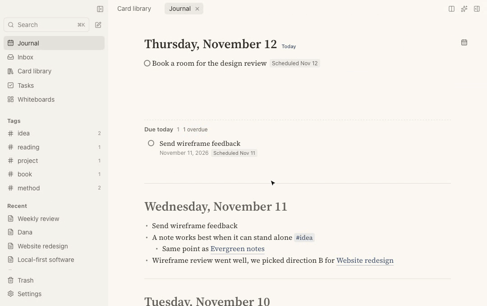
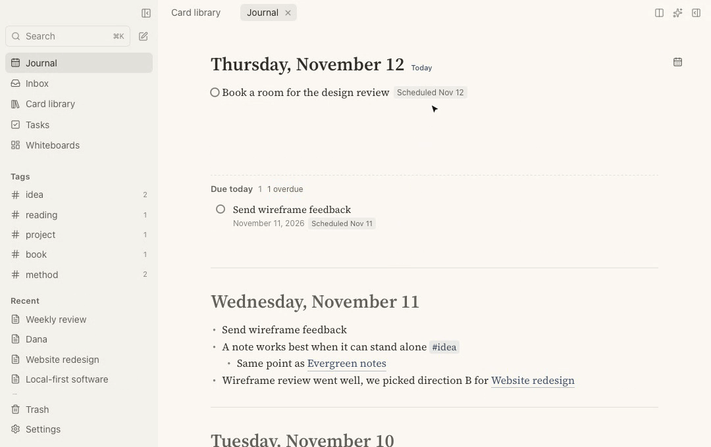
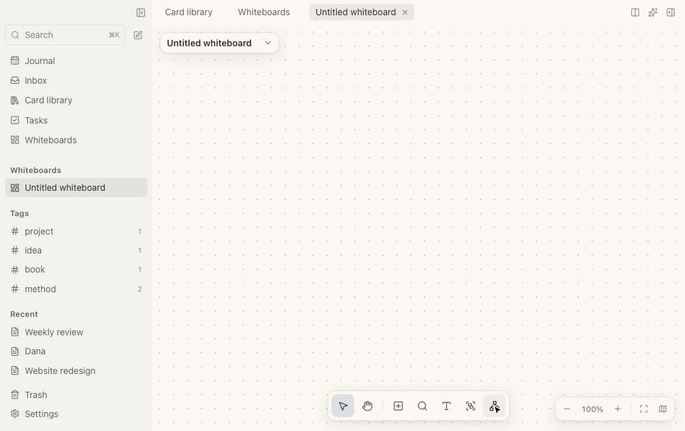
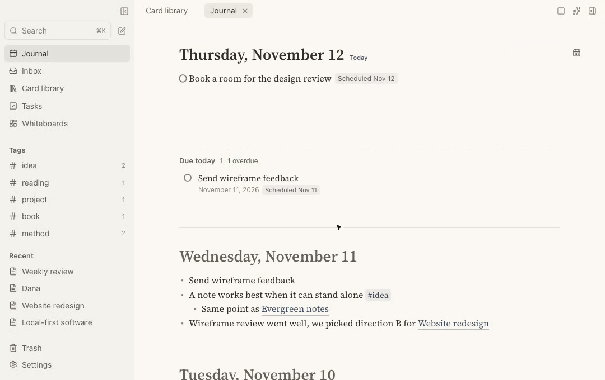
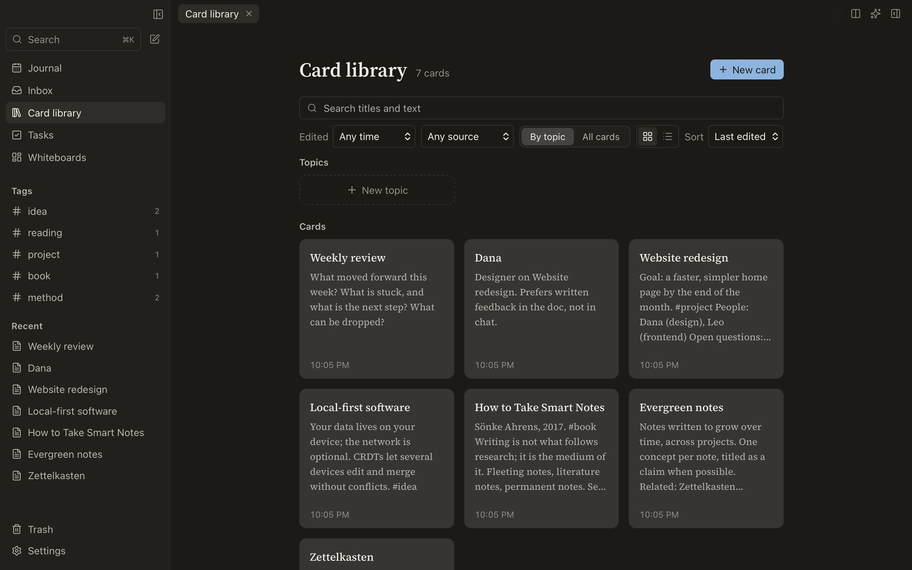

<p align="center"></p>
<h1 align="center">Folio 页</h1>
<p align="center"><a href="README.md">English</a> · <b>简体中文</b></p>

<p align="center"><b>本地优先的笔记应用，适合用大纲和链接思考的人。</b><br>
日记、互相链接的卡片、任务、实时查询和白板，都在一个轻快的应用里。<br>
笔记只存在你自己的设备上。</p>

<p align="center"><a href="#下载"><b>下载</b></a> · <a href="#功能">功能</a> · <a href="#自己部署同步服务">同步服务</a> · <a href="#开发">开发</a></p>



> 动图录制的是英文界面，应用自带简体中文。

## 为什么用 Folio

- **笔记是你的。** 它们存在你设备上的一个 SQLite 文件里，离线可用。不需要账号，也没有必须信任的云。随时可以全部导出为 Markdown。
- **一个应用顶三个。** 带日记的大纲笔记、卡片库、任务管理和白板，用的是同一份笔记、同一套链接。
- **先简单，需要时再强大。** 打开今天就能写。链接、标签、查询、标签字段，在笔记需要时才出场，平时不碍事。
- **轻快。** 用 Tauri 和 Rust 做的原生应用，支持 macOS、Windows、Linux 和安卓。

## 快速一览

### 顺着思路写

打开日记直接写。`[[` 链接卡片，`#` 加标签，`/` 打开所有命令，Tab 缩进。每张卡片都会列出哪些地方链接了它，今天写下的一句话，会出现在它提到的项目或人的卡片旁边。

### 向笔记提问

查询块按你的条件列出任务、块或卡片，并随着你的书写实时更新。可以从常用查询开始，点选修改条件，也可以直接写成文字：`任务:未完成 #项目 到期:<=+7天`。结果里的任务可以直接勾选。



### 在白板上铺开想法

把卡片摆到画布上、连线、用小节框起来，或者只用键盘搭思维导图：Tab 加子主题，Enter 加下一个。白板可以导出为 JSON Canvas，Obsidian 能直接打开。



### 什么都找得到

`⌘K` 边输入边搜索卡片、日记和块的标题与正文，可以按时间和标签筛选。



### 装进口袋

安卓上是同一份笔记，版式为单手操作设计。点两下记下一个想法，勾掉任务，打开任何一张卡片都能看到链接到它的内容。

<p align="center"></p>

### 浅色与深色



## 功能

**书写**
- 日记和卡片用同一个编辑器：可折叠的大纲、标题、表格、代码块、数学公式、Mermaid 图表、图片和文件。
- 卡片链接、块引用与嵌入、反向链接和未链接的提及。
- 模板，以及每张卡片的历史版本。

**整理**
- 带字段的标签：给标签加上状态或日期字段，用表格或看板查看它的卡片。
- 查询块：实时列出任务、块或卡片，可以点选，也可以写成文字。
- 用主题给卡片分组；收件箱先存下链接和一闪而过的想法（安卓上可以从任何应用分享到 Folio）。
- 白板与思维导图。
- 搜索与命令，都从 `⌘K` 进入。

**把事做完**
- 任务有状态、优先级、计划日期和截止日期。
- 任务页、日历，还有习惯打卡。

**你的数据**
- 存在设备上的 SQLite 里，离线可用。
- 自动备份，可以在你选的文件夹里再存一份加密副本；删除的卡片进废纸篓，可以恢复。
- 随时导出为 Markdown 或 PDF。
- 同步（开发中）：端到端加密，经过你自己部署的服务器，服务器只看得到加密后的数据。Loro CRDT 合并多台设备的修改，不产生冲突。

**AI（可选）**
- 助手使用你自己的 API key（Anthropic 或任何兼容 OpenAI 的服务），修改先给你审阅。
- MCP 服务，让其他 AI 工具在你同意后读写笔记。

English 和简体中文。macOS、Windows、Linux、安卓；iOS 在计划中。

## 下载

在 [Releases](https://github.com/linlih/folio/releases/latest) 下载最新版本：

| 平台 | 文件 |
|---|---|
| macOS（Apple 芯片与 Intel） | `Folio_x.y.z_universal.dmg` |
| Windows | `Folio_x.y.z_x64-setup.exe` 或 `.msi` |
| Linux | `.AppImage`、`.deb` 或 `.rpm` |
| 安卓（arm64） | `folio-android-arm64.apk` |

桌面应用每天检查一次更新，安装前会先询问（Linux 上是 AppImage；`.deb` / `.rpm` 通过系统的包管理器更新）。安卓应用会在有新 APK 时提示。

安装包暂未经过苹果和微软签名。macOS 首次打开需在“系统设置 → 隐私与安全性”里允许；Windows 上点“更多信息 → 仍要运行”。

## 自己部署同步服务

在一台有 systemd 的 Linux 服务器上，先把域名解析到它，然后运行：

```bash
curl -fsSL https://raw.githubusercontent.com/linlih/folio/main/scripts/install-server.sh | sudo bash -s -- --domain sync.example.com
```

脚本把所有文件装在 `/opt/folio-sync`（程序、设置和令牌、数据、按天轮转的日志），注册为 systemd 服务 `folio-sync`，用 Caddy 配好 HTTPS（机器上没有 Caddy 时，把 Caddy 官方发布的程序校验后装进 `/opt/folio-sync`，作为服务 `folio-sync-caddy` 运行，不需要包管理器；已经有 Caddy 时会先询问再往现有的 Caddyfile 里加站点；`--https-port` 可以换掉 443 端口），最后打印服务器地址和令牌，填到应用的“设置 → 同步”里即可。服务器上只有加密后的数据。

在终端里不带参数运行时，会按步骤询问域名、公网 HTTPS 端口（默认 443；换成别的端口可以避开大部分扫描）和本机端口，列出安装计划，同意后才开始。无人值守安装用 `--domain`、`--https-port`、`--port` 和 `--yes`。

用 `folio-sync` 命令管理：

```
folio-sync status | start | stop | restart | logs -f | info | upgrade | uninstall [--purge]
```

## 开发

基于 Tauri 2、React 和 Rust。

### 目录

```
crates/
  folio-core/     领域模型：文档 id、卡片文档结构（Loro）、内容提取；无 IO
  folio-store/    SQLite：唯一写入者、增量日志、派生索引、本机设置
  folio-sync/     客户端同步
  folio-io/       导入导出
  folio-mcp/      MCP 服务（让 AI 访问笔记）
  folio-server/   同步中继服务
src-tauri/      Tauri 2 外壳：IPC 命令、窗口、日志与诊断
web/            React 前端：设计系统、国际化、应用外壳、平台抽象
scripts/        字体、测试、发布等脚本
design/         方案与决策文档
spike/          早期技术预研，留作参考
```

计划中：`packages/`（插件 SDK）与 `plugins/`（内置插件）。

方案与决策：[`design/ARCHITECTURE.md`](design/ARCHITECTURE.md)，ADR 在 [`design/adr/`](design/adr/)，调研在 [`design/research/`](design/research/)。

### 运行

需要：Rust（stable）、Node.js 22+，macOS 上还需要 Xcode Command Line Tools。

```bash
./scripts/fetch-fonts.sh
```

```bash
npm install
```

只看前端（浏览器 + 内存里的模拟后端）：

```bash
npm run dev
```

桌面应用（Tauri）：

```bash
npm run tauri dev
```

全部测试（Rust，然后是前端类型检查与单测）：

```bash
npm test
```

### 构建与发布（GitHub Actions）

- **CI**：每次推送到 `main` 跑全部测试。
- **发布新版本**：`./scripts/release.sh 0.2.0 -m "更新说明" --push`。脚本更新所有版本号、提交，并推送一个标签，标签说明就是发布说明。标签会构建并发布 Release：安装包、签名的更新包、`latest.json`（已安装的应用据此检查更新）和安卓 APK。详见 `design/ARCHITECTURE.md` 7.3。
- **Build apps** 也可以在 Actions 页面手动运行：只构建、不发布，产物在这次运行的 Artifacts 里保留 14 天。
- **iOS** 目前只检查能否编译；装到 iPhone 需要苹果开发者账号与签名（见 7.2）。

签名密钥在仓库 Secrets 里：更新签名用 `TAURI_SIGNING_PRIVATE_KEY` 及其密码，APK 签名用 `ANDROID_KEYSTORE_B64` 和 `ANDROID_KEYSTORE_PASSWORD`。
